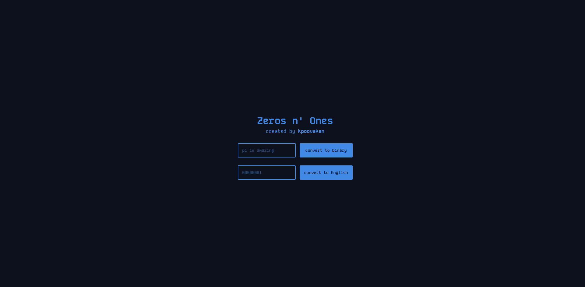

# zerosnones
Convert plain English to binary and back!



### Quick Setup
Open this web app [here](https://kpoovakan.github.io/zerosnones). This opens an online demo that works anywhere on the web. All code is frontend, meaning that anything you translate will stay on your computer. It won't be sent to us or stored by us.

### Features
* Convert English text (or any text, really) to binary
* Convert binary back to its original text (probably in English, although Indonesian is possible too)
* Easily copy results to clipboard with the click of a button
* Lightweight scripts that can run anywhere on the web

### Running Locally
```bash
git clone https://github.com/kpoovakan/zerosnones.git
```
No dependencies or packages to install. Simply open the repository folder and open `index.html`

### Tech Stack
* JavaScript (frontend)
* CSS
* HTML

Lightweight, with no dependencies.

### Credits And Licensing
Zerosnones is built by [kpoovakan](https://kpoovakan.github.io) and licensed under the [LICENSE]().